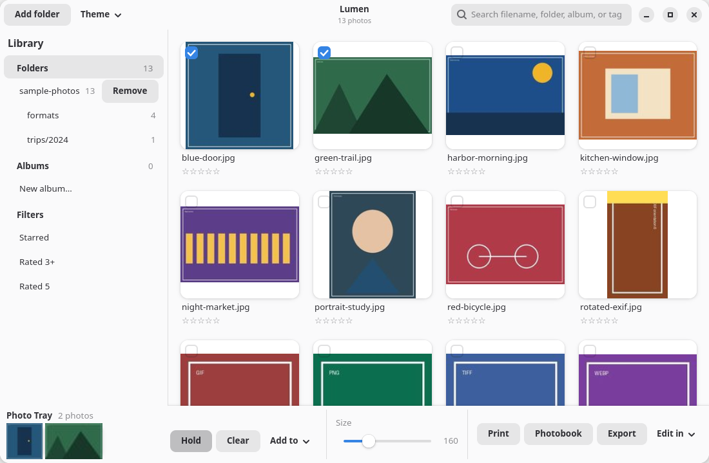
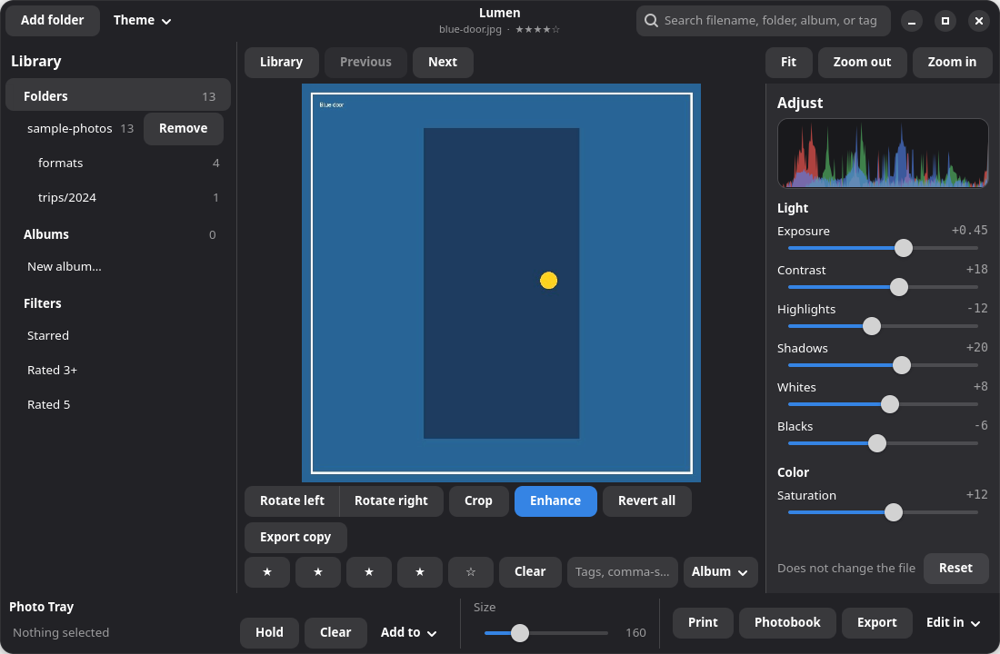

# Lumen

Lumen is a small, Picasa-inspired photo organizer for Linux, with builds for Windows and macOS. Point it at folders you already have, browse a thumbnail grid, rate, tag and album your pictures, make light non-destructive edits, and build simple photobooks — without ever rewriting your originals.

> **Unofficial.** Lumen is an independent project. It is not affiliated with, endorsed by, or connected to Google or Picasa. It uses no Google code, names, icons, or other assets; the name, icon and layout are original.

Lumen is a native windowed Python app built with GTK 4 and libadwaita (PyGObject), with Pillow for image work. No web view, no extra framework.

## Screenshots





## Features

- **Library** — add one or more folders; scanned recursively for jpg, jpeg, png, webp, gif, tif, tiff (any case). Hidden files are skipped. Folders and Albums collections with photo counts, starred filter, and search across filename, folder, album and tag.
- **Albums, ratings, tags** — a photo can be in several albums without moving the file; 0–5 star ratings (keys 1–5 in the viewer); comma-separated tags.
- **Viewer** — previous/next, fit, zoom, arrow keys, Escape back to the library.
- **Edit panel with live sliders** — RGB histogram, Exposure, Contrast, Highlights, Shadows, Whites, Blacks, Saturation; rotate, crop, Enhance. Edits are stored as an operation list and applied on display/export only. *Export a copy* never overwrites the original.
- **Photo Tray** — click, Ctrl+click, Shift+click, rubber-band select, Hold to collect across folders, Ctrl+A / Escape.
- **Photobook, PDF and print** — A4 booklet alternating 1-up and 2-up pages, exported to PDF or printed via the GTK print dialog, with edits applied.
- **Open in Darktable or GIMP** — native or Flatpak installs are detected; edited photos are handed over as exported copies.
- **Import from card or camera** — removable disks via udisks2/Gio, cameras via optional `gphoto2`, or any folder. Copies only, never moves; existing names are skipped.
- **Backup** — incremental copy of all indexed photos plus a library database snapshot to any folder (local disk, NAS mount, or a cloud-synced folder).
- **Theme** — Light, Dark, or Follow system (libadwaita), plus an adjustable thumbnail size.

Not in v1: faces, maps, raw decoding (raw files can be imported but not opened), video, retouch brushes, drag-to-crop, slideshows, cloud sign-in, duplicate detection.

## Download

Get the latest installer from the [Releases page](https://github.com/gauthampalaniappan/lumen/releases/latest):

| System | File | Install |
| --- | --- | --- |
| Windows 10/11 (64-bit) | `Lumen-<version>-windows-x64-setup.exe` | Run it. No admin rights needed. A portable `.zip` is also provided. |
| macOS, Apple Silicon | `Lumen-<version>-macos-arm64.dmg` | Open it and drag Lumen to Applications. |
| macOS, Intel | `Lumen-<version>-macos-x86_64.dmg` | Same as above. |
| Fedora | `lumen-<version>-1.<fc>.noarch.rpm` | `sudo dnf install ./lumen-*.rpm` |
| Debian 13, Ubuntu 25.04 or newer | `lumen_<version>-1_all.deb` | `sudo apt install ./lumen_*.deb` |

The Windows and macOS builds are not code-signed yet, so the first launch shows a warning. On Windows choose **More info → Run anyway**. On macOS, try to open Lumen once, then go to **System Settings → Privacy & Security** and choose **Open Anyway**.

On Windows and macOS everything works except importing straight from a camera (that needs `gphoto2`). To import from a memory card, choose its folder in the import dialog.

## Requirements (running from source)

- Linux with a graphical session
- Python 3
- PyGObject, GTK 4 (with GObject introspection typelibs), libadwaita — Lumen does not fall back to GTK 3
- Pillow
- Optional: `gphoto2` (camera import), `darktable` / `gimp` (external editing)

On Fedora (package names verified on 2026-09-30 at <https://packages.fedoraproject.org> for Fedora 43, 44, 45 and Rawhide):

| Package | What it is |
| --- | --- |
| `python3-gobject` | PyGObject, including cairo bindings |
| `python3-gobject-base` | The `gi` module |
| `gtk4` | GTK 4 and the `Gtk-4.0` / `Gdk-4.0` typelibs |
| `libadwaita` | libadwaita and the `Adw-1` typelib |
| `python3-pillow` | Pillow |

## Install on Fedora

```bash
git clone https://github.com/gauthampalaniappan/lumen.git
cd lumen
./install-fedora.sh
```

This runs `sudo dnf install python3-gobject python3-gobject-base gtk4 libadwaita python3-pillow` and installs Lumen for the current user under `~/.local` (override with `PREFIX=...`):

- `~/.local/bin/lumen`
- `~/.local/share/lumen/`
- `~/.local/share/applications/org.lumen.Lumen.desktop`
- `~/.local/share/icons/hicolor/scalable/apps/org.lumen.Lumen.svg`

If the packages are already installed: `SKIP_DEPS=1 ./install-fedora.sh`. Then launch **Lumen** from your app menu or run `lumen`.

## Run from source

```bash
python3 lumen.py
python3 lumen.py --library ~/Pictures/2024 --library ~/Pictures/scans
python3 lumen.py --library ./sample-photos
```

`--library` can be repeated; folders are remembered in the config. `sample-photos/` contains small generated test images (regenerate with `python3 scripts/make_samples.py`; it also contains a few deliberate edge cases such as a hidden file and non-image files).

## Uninstall

```bash
PREFIX="${PREFIX:-$HOME/.local}"
rm -rf "$PREFIX/share/lumen/lumen" "$PREFIX/share/lumen/lumen.py"
rm -f  "$PREFIX/bin/lumen" \
       "$PREFIX/share/applications/org.lumen.Lumen.desktop" \
       "$PREFIX/share/icons/hicolor/scalable/apps/org.lumen.Lumen.svg"
# Optional: remove your library data, settings and cache
rm -rf ~/.config/lumen ~/.local/share/lumen ~/.cache/lumen
```

Your photos are never touched.

## Where data lives

Lumen follows the XDG base directory spec; no home path is hardcoded.

| What | Path |
| --- | --- |
| Config (folders, theme, thumbnail size, backup folder) | `$XDG_CONFIG_HOME/lumen/config.json` (default `~/.config/lumen/config.json`) |
| Library database | `$XDG_DATA_HOME/lumen/library.db` (default `~/.local/share/lumen/library.db`) |
| Thumbnail cache | `$XDG_CACHE_HOME/lumen/thumbs` (default `~/.cache/lumen/thumbs`) |
| Editor export copies | `$XDG_CACHE_HOME/lumen/edit-export` (default `~/.cache/lumen/edit-export`) |

On Windows, settings go in `%APPDATA%\Lumen` and the library database and caches in `%LOCALAPPDATA%\Lumen`. On macOS they go in `~/Library/Application Support/Lumen` and `~/Library/Caches/Lumen`. Setting the `XDG_*` variables overrides these on any system.

Note: when installed with the default prefix, the app code (`~/.local/share/lumen/`) and the library database share a directory; the uninstall commands above remove only the code (keeping `library.db`) unless you run the optional line.

## Project layout

```
lumen.py               entry point
lumen/                 application package (UI, store, imaging, photobook, import, backup, editors, paths)
share/                 .desktop file and SVG icon
scripts/               sample generation and headless checks
sample-photos/         small generated test images
docs/screenshots/      README screenshots
install-fedora.sh      per-user installer for Fedora
packaging/             release builds: Linux .rpm/.deb, Windows installer, macOS .dmg
.github/workflows/     release workflow (builds every package on a version tag)
```

## Releasing

Bump `__version__` in `lumen/__init__.py`, add a `<release>` line to `share/org.lumen.Lumen.metainfo.xml`, push to `main`, then run **Actions → Release → Run workflow** with **Create draft release** ticked (or push a tag such as `v0.2.0`). GitHub Actions builds and launch-tests every package and puts them in a draft release for you to publish. Details are in [packaging/README.md](packaging/README.md).

## Development checks

```bash
python3 -m py_compile lumen.py lumen/*.py scripts/*.py
python3 scripts/check_library.py
python3 scripts/check_import.py
python3 scripts/check_backup.py
```

The check scripts run headless and use temporary XDG directories. `check_import.py` and `check_backup.py` create their temp folder inside the checkout by default (Lumen deliberately ignores volumes under `/tmp`); set `LUMEN_CHECK_TMP` to use another non-`/tmp` folder.

## Contributing

Issues and pull requests are welcome. Please keep changes small and focused, run the checks above before submitting, keep the app GTK 4 / libadwaita native, and never add code that rewrites original photos. Do not contribute Google or Picasa assets.

## License

[MIT](LICENSE) © 2026 Gautham Palaniappan
